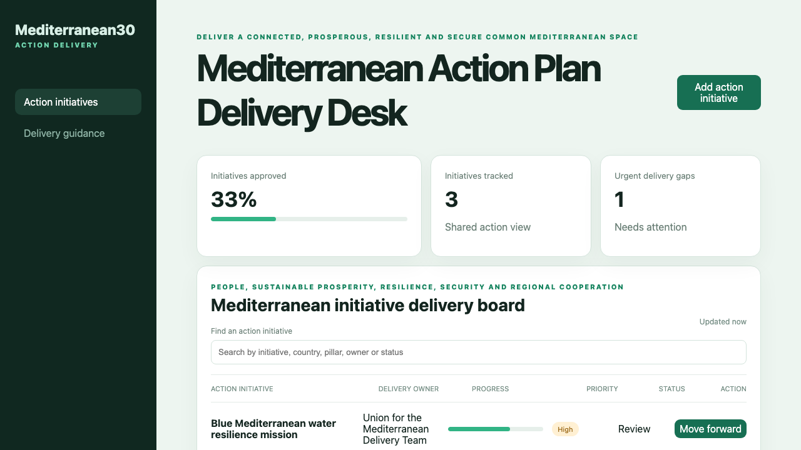

# Mediterranean Action Plan Delivery Desk

## One-sentence benefit

Coordinate people, prosperity and security initiatives across the EU’s Common Mediterranean Space.

## Live demo

[Watch the workflow](docs/demo.webm).

## Screenshots

## Main features

- Search and sort initiatives across pillars, partners and owners.
- Create a delivery initiative through the Java service.
- Advance initiatives toward approval.
- Consult delivery guidance on a separate route.
- Handle loading, empty, error and success states responsively.

## Technology used

Vue 3, TypeScript, Pinia, Vue Router, Vite, Spring Boot and Java 21.

## Installation instructions

Install Node.js 22 and Java 21. Run `npm install`, start the backend with `cd backend && mvn spring-boot:run`, then run `npm run dev`.

## Commercial licensing/contact

Commercial licensing and integration support are available through the repository contact options.

## Business problem and users

Regional authorities, programme teams, civil-protection bodies and delivery partners need one accountable view of cross-border initiatives and dependencies.

## Key workflows

Find an initiative, add a delivery action, review its owner and priority, advance its state and consult guidance.

## Vue framework highlights

Pinia provides reactive API state and metrics, Vue Router separates operational and guidance views, and templates expose accessible updates.

## Java backend highlights

Spring Boot supplies validated list, search, create and update APIs, consistent errors, health reporting and Java tests.

## Architecture and state flow

Vue actions call `/api/items`; Java validates requests, owns workflow transitions and returns records to the Pinia store.

## Accessibility and responsive behaviour

Labelled search, semantic navigation, keyboard controls and layouts that collapse cleanly support multiple devices.

## Verification commands

Run `npm test`, `npm run build`, `cd backend && mvn test` and `cd backend && mvn package`.

## Structure

`src` holds Vue routes and state, `backend` holds the API and `docs` holds inspected media.

## Tradeoffs

The sample uses in-memory records; production should add identity, persistent milestones and partner data exchange.

## Roadmap

Add pillar portfolios, country dependencies, funding milestones, maps and regional risk alerts.
